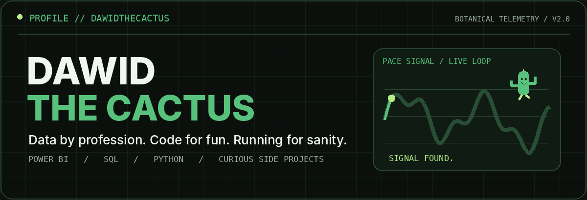
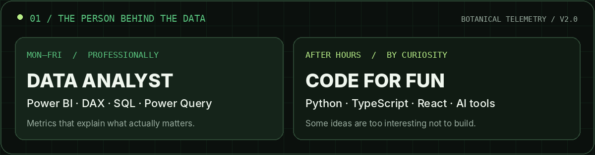
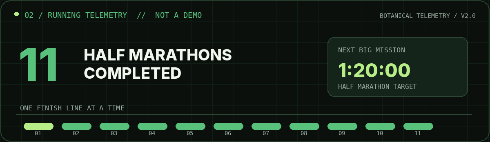
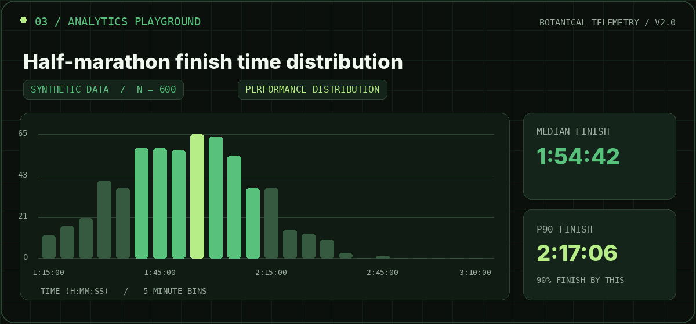
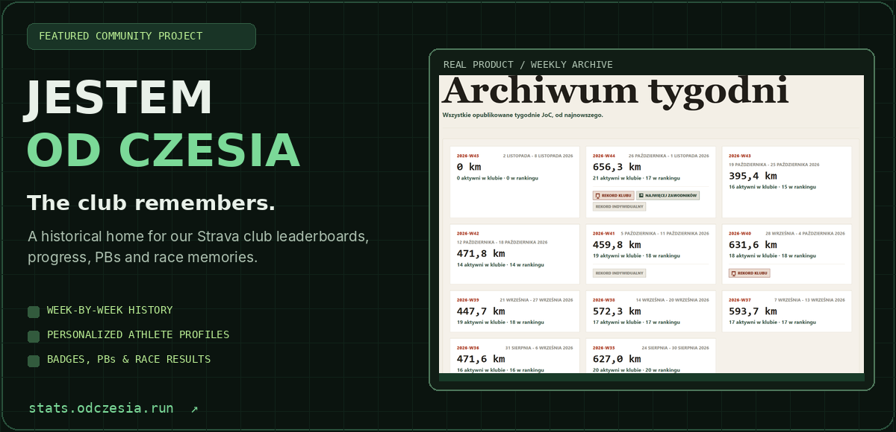
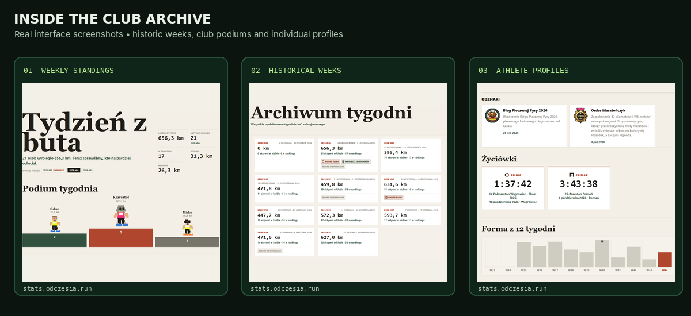
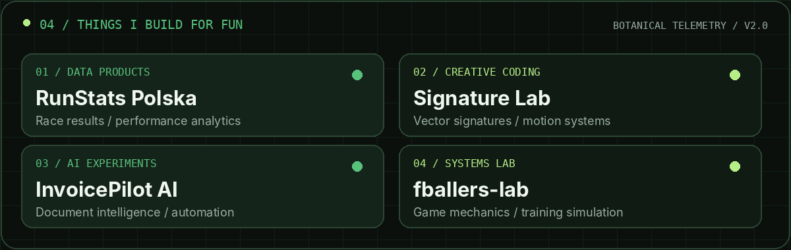
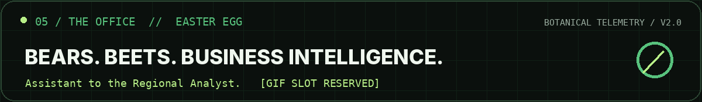
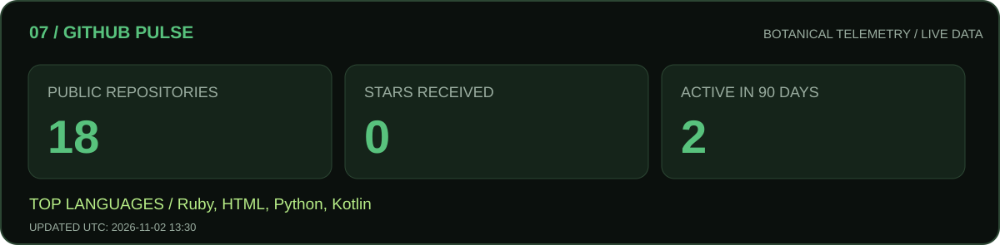

<div align="center">
  
</div>

<p align="center">
  <strong>Data Analyst · Power BI Developer · Curious Builder · Half-Marathon Enthusiast</strong><br>
  <sub>Turning messy data into useful decisions, then using the weekend to build something unnecessarily fun.</sub>
</p>

<p align="center">
  <a href="https://stats.odczesia.run">Jestem od Czesia archive</a>
  ·
  <a href="#03--analytics-playground">Analytics playground</a>
  ·
  <a href="#04--things-i-build-for-fun">Side projects</a>
  ·
  <a href="#05--runningexe">Running.exe</a>
</p>

### 01 // The person behind the data



Hey, I'm **Dawid**. I turn fragmented business data into reports, models and insights people can actually use. I spend a lot of time with **Power BI, DAX, Power Query, SQL and Python**.

When I clock out, I sometimes keep building anyway. Just for fun. Usually something involving running statistics, automation, game mechanics or a weirdly specific problem worth solving.

### 02 // Cactus metrics



**11** half marathons completed. Current half-marathon target: **1:30:00** for 21.0975 km. I like races, but I probably like analyzing them almost as much. 🌵

### 03 // Analytics playground



> **Demo, not actual race results.** The chart is based on 600 reproducibly generated, synthetic finishing times. It's a tiny example of the questions I like asking: Where's the distribution centered? What does the tail tell us? How different are the typical and slower finishes?

<details>
<summary><strong>How the demo works</strong></summary>

The synthetic dataset is generated from a seeded distribution. The histogram uses five-minute intervals, and median / 90th percentile values are calculated from those same generated numbers. A summary is stored in <a href="./docs/synthetic-data.json">docs/synthetic-data.json</a>. No real participants are represented.
</details>

### 04 // Things I build for fun

#### Featured analytics project · Jestem od Czesia

<a href="https://stats.odczesia.run" title="Explore the Jestem od Czesia running club archive">
  
</a>

**[Jestem od Czesia Stats](https://stats.odczesia.run)** is a data-driven archive for our running club in **Swarzędz, Poland**, built around statistics from the club on Strava. Strava's *club leaderboard* is focused on the current week; I wanted a way to revisit previous weeks, compare our progress over time, and celebrate the people behind those kilometers.

The result goes beyond an archive:

- **Historical club rankings:** browse previous weeks, distances, participation, leaderboards and weekly highlights.
- **Progress and trends:** revisit earlier results, see who improved, and follow the club's evolving performance.
- **Personal athlete profiles:** each club member can personalize their profile and collect achievements and medals.
- **PBs and race history:** keep personal bests and a history of race starts together on each runner's profile.

<a href="https://stats.odczesia.run" title="See Jestem od Czesia weekly rankings, archive, and athlete profiles">
  
</a>

**[Explore the live running-club dashboard →](https://stats.odczesia.run)** · Built for runners, by a runner. 👟

#### More experiments



**RunStats Polska** explores running results and performance patterns. **Signature Lab** experiments with vector drawing and motion. **InvoicePilot AI** is about smarter document workflows. **fballers-lab** scratches the itch to measure and understand game systems.

Some of these are private experiments or work in progress, so I won't pretend there's a public demo for everything yet. You can browse the repositories I *have* published [here](https://github.com/dawidthecactus?tab=repositories).

### 05 // Running.exe

```text
RUNNING.MODE       enabled
FINISH_LINES       11 half marathons
CURRENT_QUEST      21.0975 km in 1:30:00
LOCAL_COMMUNITY    Jestem od Czesia / Swarzędz
SIDE_EFFECTS       race spreadsheets, charts, too many running shoes
```

The overlap between running and analytics is suspiciously large: pacing, progression, distributions, variance, forecasting, and then going outside to test the model.

### 06 // Office mode

<a href="https://giphy.com/gifs/theoffice-ZfK4cXKJTTay1Ava29">
  
</a>

Yes, that panel links to a Dwight GIF. No copyrighted footage is bundled with this repository.

### 07 // GitHub pulse



<sub>The pulse widget uses public repository metadata only and is refreshed by a GitHub Actions workflow. No fabricated GitHub stars or contribution counts.</sub>

---

<p align="center">
  <strong>Still growing. Still running. Still analyzing. 🌵</strong><br>
  <sub>Built with caffeine, curiosity, and too many browser tabs.</sub>
</p>
